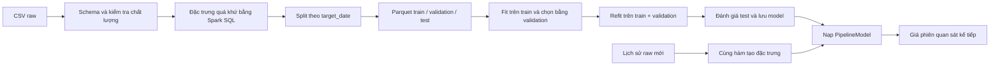

# Kiến trúc batch và hợp đồng tích hợp

## Pipeline đang triển khai



## Các ranh giới

| Thành phần | Đầu vào | Đầu ra | Trách nhiệm |
|---|---|---|---|
| `normalize_raw` | DataFrame theo raw contract | `date` DateType, các giá trị DoubleType | Kiểm tra trường bắt buộc, date duy nhất, số hữu hạn; giữ null covariates |
| `make_features` | DataFrame chuẩn hóa + Config | Features theo thứ tự ổn định; nhãn tùy chọn | Chỉ dùng quá khứ để tạo features; chỉ nhãn dùng `lead` |
| `chronological_split` | Labeled features | Ba DataFrame + khoảng ngày | Thứ tự target_date; không lấy mẫu ngẫu nhiên |
| `fit_preprocessor` | Chỉ khoảng fitting | PipelineModel imputer + assembler | Median không học từ holdout |
| `train` | Prepared Parquet + manifest | Hai PipelineModel, baseline, metrics | Grid search thời gian, refit và chọn champion bằng validation |
| `predict_latest` | Model artifact + lịch sử raw | Một kết quả dự báo có origin_date | Không fit lại preprocessing; không đoán ngày giao dịch kế tiếp |

`features.py` và phần model không gọi file API, Kafka, HDFS hay database. `cli.py` sở hữu vòng đời SparkSession; `artifacts.py` quản lý artifact local. Đầu vào có thể được thay bằng DataFrame từ adapter khác, miễn vẫn tuân theo schema và thời điểm thông tin.

## Raw contract v1

Các trường bắt buộc, mỗi ngày đúng một quan sát:

```text
Date: ISO yyyy-MM-dd
cushing_crude_oil_price: giá raw USD/thùng, hữu hạn và không null
dow_jones_adj_close_price: số hữu hạn hoặc null
nasdaq_adj_close_price: số hữu hạn hoặc null
sp_adj_close_price: số hữu hạn hoặc null
usd_to_uk_exchange_rate: số hữu hạn hoặc null
federal_funds_rate: số hữu hạn hoặc null
bank_prime_loan_rate: số hữu hạn hoặc null
treasury_1_year_rate: số hữu hạn hoặc null
breakeven_inflation_5_year_rate: số hữu hạn hoặc null
```

Schema exact giúp phát hiện nhầm dữ liệu compiled đã log. Thêm/bớt cột cần thay contract có chủ đích. Không deduplicate tùy tiện: ingestion phải quyết định bản ghi nào đúng và xử lý revision.

Feature contract v1 gồm tên target, thang đo, horizon=1, lag giá, rolling windows, độ trễ covariate và giới hạn forward-fill. Thay cấu hình này yêu cầu preprocessing/huấn luyện lại. Thứ tự feature được lưu và kiểm tra khi inference.

Artifact `manifest.json` là dấu hiệu run đã hoàn tất; kết quả từng run bất biến theo ID, không overwrite. Đây là quy ước local, chưa phải transaction protocol cho distributed storage.

## Future work — chưa triển khai

### Kafka, do thành viên khác phụ trách

Chưa cố định topic hoặc format message trong code. Đầu ra adapter cần chuẩn hóa về raw contract v1; metadata vận hành như instrument, event time, ingestion time, published time và event ID nên được thiết kế trước khi mở rộng contract. Với CSV replay, phát theo thứ tự Date nhưng phải phân biệt ngày thị trường lịch sử với thời gian phát lại.

Không đưa DataFrame streaming trực tiếp vào `make_features`: `lead`, global sort, window theo số dòng và các action validation hiện tại là **batch-only**. Streaming cần quản lý state/history, watermark, late data, deduplication và chính sách revision. Có thể bắt đầu bằng micro-batch lưu lịch sử rồi chạy batch scoring, sau khi chốt ngữ nghĩa thời gian. Chỉ train khi nhãn phiên tiếp theo đã có.

### HDFS

Parquet và Spark reader/writer giúp chuẩn bị định dạng. Remote artifact store cho model/JSON manifest, quyền truy cập, commit protocol, checkpoint và partition strategy chưa có; không chỉ thay `output_dir` bằng HDFS URI. Hiện config chủ động từ chối remote output để không tạo cảm giác hỗ trợ giả.

### Database

Chưa chọn database hoặc tạo schema. Khi triển khai, bảng kết quả cần định danh run/model/version, origin_date, horizon, target_date khi biết, prediction và đơn vị. Upsert/idempotency phải được thiết kế với adapter ghi, không đặt trong estimator.

### Docker/deployment

Chưa có Dockerfile, Compose, service definitions hoặc orchestration. Dependency Spark được pin; runtime config tách khỏi transformations. Container Linux tạm có thể được dùng để kiểm thử trên máy Windows, không phải thành phần triển khai của repo.

## Giới hạn phân tán

Đây là một chuỗi dầu duy nhất nên `Window.orderBy(date)` không partition. Spark có thể đưa toàn chuỗi về một partition để tạo lag/rolling. Không quảng bá pipeline này là benchmark Big Data. Khi bổ sung nhiều chuỗi, cần khóa instrument và `partitionBy(instrument)`, lịch giao dịch tương ứng, rồi đo chi phí shuffle, skew và memory với dữ liệu đủ lớn.
